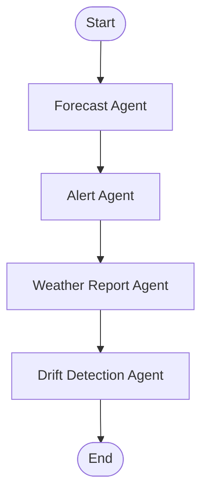

# AETHERIX AI — AgentWeather

A free, local-first Karachi weather and air-quality forecasting project. Day 1
provides live Open-Meteo forecast clients. Day 2 adds historical data ingestion,
timestamp alignment, data-quality reporting, causal feature engineering, and
24-hour prediction targets. Day 6 runs four local LangGraph agents and saves
their decisions in SQLite. The default workflow requires no API key or paid
service.

Open-Meteo historical weather values are reanalysis/model estimates.
Air-quality and AQI values are modeled CAMS estimates, not direct sensor
observations and not predictions from a trained AETHERIX model.

## Requirements and installation

- Python 3.12
- Git
- Internet access for the live API smoke test and historical backfill

From the project directory in PowerShell:

```powershell
py -3.12 -m venv .venv
.\.venv\Scripts\Activate.ps1
python -m pip install --upgrade pip
python -m pip install -r requirements.txt
python -m pip install --index-url https://download.pytorch.org/whl/cpu -r requirements-day4b-cpu.txt
```

Day 1 and Day 2 use the Python standard library plus `requests`; Day 3 adds
Pandas, Matplotlib, and scikit-learn for local analysis and CPU-only models.
Day 4A adds statsmodels for a local statistical forecasting experiment. Tests
use `pytest`. Generated `data/` and `artifacts/` files are ignored by Git.

## Day 2 architecture

```text
Open-Meteo Historical Weather API ─┐
                                   ├─> data/raw/*.csv
Open-Meteo Air Quality API ─────────┘          │
                                               ├─> exact UTC outer join
                                               ├─> missing-data/QC report
                                               └─> causal features + targets
                                                    data/processed/features.csv
                                                    data/reports/quality_report.*
```

- `aetherix_weather/historical.py`: historical clients, date validation,
  timestamp normalization, source availability, and raw provenance.
- `aetherix_weather/storage.py`: atomic CSV/JSON persistence and timestamp-keyed
  upserts.
- `aetherix_weather/dataset.py`: exact-hour alignment, missing summaries,
  optional limited forward fill, quality checks, features, and targets.
- `scripts/backfill.py`: fetches and persists a historical range, then creates
  the processed dataset and reports.
- `scripts/build_features.py`: rebuilds processed data from existing raw CSVs
  without making API requests.
- `scripts/refresh_historical_uv.py`: updates an existing air-quality dataset
  with cloud-aware hourly UV without re-fetching weather.
- `scripts/backfill_forecast_information.py`: stores forecast probabilities
  separately from observation-aligned features and targets.

## Historical sources and supported variables

- [Open-Meteo Historical Weather API](https://open-meteo.com/en/docs/historical-weather-api)
  at `https://archive-api.open-meteo.com/v1/archive`.
- [Open-Meteo Air Quality API](https://open-meteo.com/en/docs/air-quality-api)
  at `https://air-quality-api.open-meteo.com/v1/air-quality`.
- [Open-Meteo Historical Forecast API](https://open-meteo.com/en/docs/historical-forecast-api)
  at `https://historical-forecast-api.open-meteo.com/v1/forecast`.
- Default location: Karachi, Pakistan (`24.8607`, `67.0011`), timezone
  `Asia/Karachi`.
- Weather variables requested: temperature (°C), relative humidity (%),
  precipitation (mm), precipitation probability (%), wind speed (km/h), wind
  direction (degrees), and UV index.
- Air-quality variables requested: US AQI, PM2.5 (µg/m³), and cloud-aware UV
  Index.

The historical weather archive returned all-null hourly UV and precipitation
probability for the 90-day run. A separate 90-day request to the Air Quality
API returned 2,160 non-null hourly `uv_index` values for Karachi (including
nonzero daytime readings). The pipeline uses that cloud-aware UV Index, not
`uv_index_clear_sky`; its unit is the dimensionless UV index (the response's
`hourly_units` value is blank). US AQI and PM2.5 are modeled air-quality values,
not local sensor observations. The joined dataset records whether each UV
value came from the weather archive or the air-quality API.

The Historical Forecast API returned hourly precipitation-probability values
for the same 90-day period (unit `%`). This is **forecast data, not observed
rainfall**. The API response omits per-value model identity, run, issue time,
and lead time, and its documentation describes a continuous series stitched
from successive runs. It is persisted separately and excluded from features
and rain-occurrence targets because its as-of time cannot be verified. UV
availability, forecast metadata, and coverage are recorded in the manifests
and quality report.

The Historical Forecast API also supports daily `uv_index_max`, not hourly UV;
the separate cloud-aware hourly UV source above is used instead.

The default 90-day request ends six days behind the current date as a
conservative buffer for incomplete/recent archive data. The APIs may still
return a shorter range, null values, or hourly gaps; those are reported rather
than filled with forecast data or fabricated values. Historical weather is a
reanalysis/model record; the air-quality endpoint returns modeled CAMS data.
See the linked API documentation for dataset coverage, update cadence, and
usage terms.

The Historical Weather API supports much older weather reanalysis. The
## Day 4B: lightweight PyTorch LSTM temperature forecast

Day 4B adds a CPU-only PyTorch 48-hour to 24-hour temperature forecast. The
experiment uses 17 issue-time features, including observed weather variables,
calendar cycles, and 24/48-hour temperature context. Target columns and
archived forecast-provider data are excluded from inputs.

Architecture and settings:

- Input sequence: 48 hourly observations, shape `(batch, 48, 17)`
- LSTM: 1 layer, hidden size 32, batch first
- Dense output: 24 temperature values
- Optimizer: Adam, learning rate 0.001
- Loss: MSE
- Batch size: 32
- Maximum epochs: 15
- Early stopping patience: 3
- Random seed: 42
- CPU threads: 2
- PyTorch: 2.6.0+cpu
- Python: 3.12.10

The processed dataset has 17,448 UTC rows. The 70/15/15 chronological
boundaries are rows 12,213 and 14,830. LSTM origins reserve 24 future hours,
so the test partition contains 2,594 sequences. Each origin uses only rows
ending at or before the issue timestamp, and target timestamps are issue + 1
through issue + 24 hours. Training-only median imputation and standard scaling
are fitted only on training sequences.

The two-epoch pilot completed in 8.5 seconds with finite losses
(train 0.217815 to 0.053487; validation 0.041602 to 0.033957). Full training
completed 13 epochs before early stopping in 73.4 seconds; epoch 10 was the
best validation checkpoint. Final unscaled validation loss was not recorded,
but the best scaled MSE was 0.029212. Final checkpoint epoch 13 scaled train
loss was 0.026091 and validation loss was 0.029432.

Test MAE/RMSE/R2 for the 2,594 common test issues:

| Horizon | LSTM MAE | LSTM RMSE | LSTM R2 |
| ---: | ---: | ---: | ---: |
| h01 | 0.464273 | 0.661348 | 0.934197 |
| h06 | 0.717498 | 1.055184 | 0.834833 |
| h12 | 0.773972 | 1.119674 | 0.816126 |
| h24 | 0.731122 | 1.058023 | 0.835665 |

On the exact same 2,594 issue timestamps, seasonal-naive MAE was 0.572860
(h01), 0.573747 (h06), 0.574942 (h12), and 0.578296 (h24). Ridge selected
MAE was 0.283505 h01, 0.596326 h12, and was not selected in the existing
production h24 comparison. Random Forest MAE was 0.630725 h06 and 0.593870
h24. Existing SARIMAX h24 MAE was 0.612260. Therefore the LSTM beat neither
naive nor Ridge in this experiment and also did not beat the existing h24
Random Forest or SARIMAX comparisons.

Artifacts are written to `artifacts/day4b/`:

- `lstm_checkpoint.pt`: best model state and reproducibility metadata
- `lstm_per_horizon.csv`: test metrics h01-h24
- `lstm_test_predictions.csv`: issue, target, actual, and prediction records
- `model_comparison.csv`: exact-sample classical comparisons
- `training_loss.png`
- `actual_vs_predicted_h01.png`
- `per_horizon_mae.png`

Reproduce with the project virtual environment:

```powershell
.\.venv\Scripts\python.exe -m scripts.train_lstm --pilot-only --pilot-epochs 2 --epochs 15
.\.venv\Scripts\python.exe -m scripts.train_lstm --skip-pilot --epochs 15 --patience 3
.\.venv\Scripts\python.exe -m scripts.train_lstm --evaluate-only
.\.venv\Scripts\python.exe -m pytest -q
```

Limitations: only temperature is trained in this phase; the 17-feature schema
is intentionally small; CPU training used a fixed 48/24 split and 13 completed
epochs; no hyperparameter search or GPU setup was used. The LSTM prediction
quality is worse than seasonal-naive and Ridge at several horizons, so it is
not automatically promoted over existing production candidates.
Air Quality API's global CAMS archive supports older dates, with the
documentation describing 3-hourly underlying global model data from August
2022 and a finer global grid from November 2024. The API response is
hourly-indexed; hourly timestamps do not mean the underlying AQI model has
hourly independent source resolution. The common historical range used for
Day 3.5 begins on 2024-11-15, after a one-day Karachi sample returned AQI,
PM2.5, and UV values, and ends on the latest complete date. Weather-archive UV
and precipitation probability remain missing; neither is synthesized.

## Run a historical backfill

From the repository root:

```powershell
python -m scripts.backfill --days 90
```

Optional arguments:

```powershell
python -m scripts.backfill --days 30 --end-date 2026-10-01
python -m scripts.backfill --days 90 --max-forward-fill-hours 2
python -m scripts.backfill --days 90 --data-dir .\data
python -m scripts.backfill --start-date 2024-11-15 --end-date 2026-11-11
```

Dates are inclusive. An explicit `--end-date` later than the conservative
latest-full-day cutoff is rejected. Use either `--days` or `--start-date`;
when `--start-date` is supplied without `--end-date`, the latest complete day
is used. Re-running a range upserts records by exact UTC timestamp; unrelated
stored dates are retained and duplicate rows are not appended. The manifest
records both the most recent request and the total stored coverage. Successful
runs write:

- `data/raw/weather.csv` and `data/raw/air_quality.csv`
- `data/raw/manifest.json` with sources, units, availability, coverage, and
  schemas
- `data/raw/historical_forecast_precipitation_probability.csv` is created
  separately by the optional forecast-information command below.
- `data/processed/features.csv`
- `data/reports/quality_report.json` and `quality_report.md`

CSV raw rows retain the original API time string (`source_timestamp`), a
timezone-aware UTC key (`timestamp_utc`), Karachi-local time
(`timestamp_local`), and the UTC ingestion timestamp. Units and provider
attribution are maintained in the manifest. The quality report also gives
per-source per-variable available/missing counts and percentages, including
source-specific UV availability.

## Rebuild the feature dataset

After a backfill (or when raw CSVs already exist), run:

```powershell
python -m scripts.build_features
```

This command reads only local files and does not make an API request. It also
accepts `--max-forward-fill-hours` and `--data-dir`.

To refresh UV for an existing Day 2 raw dataset without re-fetching weather:

```powershell
python -m scripts.refresh_historical_uv
python -m scripts.build_features
```

To fetch the separately archived forecast probabilities for the date range in
the raw manifest:

```powershell
python -m scripts.backfill_forecast_information
```

This writes `data/raw/historical_forecast_precipitation_probability.csv` and
`data/raw/historical_forecast_manifest.json`. These forecast probabilities
remain separate from the model feature dataset and observed-rain labels.

## Alignment, quality, and missing-data policy

Both sources are normalized to aware UTC timestamps while retaining their
Karachi-local representations. The join is an **exact-hour outer join**: no
rounding or shifting occurs, and a row remains if just one source has a value.
Duplicate or non-monotonic timestamps and inconsistent UTC/local conversion
are rejected. Source-only timestamps, missing hourly periods, metric null
percentages, invalid value ranges, and source/feature schema changes are
recorded in the quality report.

Missing values are left unchanged by default. Per-metric missing indicators
are included in processed rows. Optional forward fill is causal and bounded;
it applies only to temperature, humidity, wind, and UV fields. Rainfall,
precipitation probability, AQI, and PM2.5 are never forward-filled. There is no
backfill, backward fill, or centered interpolation. Suspicious measurements
are reported, not automatically deleted.

## Dataset schema and features

Raw CSVs use one row per source timestamp. The processed file contains:

- UTC/local timestamp, source timestamp and source attribution/ingestion fields.
- Weather and air-quality metrics. Internal humidity, temperature, wind,
  precipitation, UV, AQI, and PM2.5 column names preserve their units in their
  names or the manifest.
- `<metric>_was_missing` and `<metric>_imputed` indicators.
- Calendar features: local hour, weekday, month, weekend, cyclical hour, and
  cyclical day-of-year.
- Causal lag features at 1, 3, 6, 12, 24, and 48 hours; trailing rolling means
  at 3, 6, 12, and 24 hours; 24-hour rolling standard deviation; and changes at
  1, 3, and 24 hours.
- Wind direction sine/cosine components, avoiding the 0°/360° discontinuity.

Lag/rolling values require the exact expected hourly timestamps; rolling
windows also require complete observations. A gap or null therefore produces
a null feature rather than borrowing a non-adjacent or future value. Rolling
windows include the current observation and past observations only.

## 24-hour targets

For each timestamp `T`, targets use the observed row at the exact
`T + horizon` UTC timestamp for horizons 1–24. Examples include
`target_temperature_h01`, `target_temperature_h24`,
`target_us_aqi_h01`, and `target_precipitation_mm_h01`. Target columns are
created only where the metric has historical values; a missing future reading
remains null. The newest rows receive no target unless the exact future data
exists.

The historical-weather archive's precipitation-probability values remain
missing; the separate Historical Forecast API probabilities are not targets.
`target_rain_occurred_hNN` is a rain-occurrence *classification label* with
the explicit rule `precipitation_mm > 0.0` (strictly greater than zero).
Missing future precipitation produces a missing label. Because the historical
weather source is reanalysis, this label is a modeled precipitation proxy,
not station-observed ground truth, and is not a probability forecast. Wind
direction targets are output as paired
`target_wind_direction_sin_hNN` and `target_wind_direction_cos_hNN` values.
Recover an angle with `atan2(sin, cos)`; do not treat degrees as an ordinary
linear target.

The report includes target availability counts per horizon and counts rows
with at least one future target. These are preparation statistics, not a claim
that a row is ready for every model or every horizon.

## Data-quality report and attribution

The report uses actual fetched/processed values and includes city/coordinates,
requested and returned dates, source row counts, available/unavailable
variables, missing percentages before and after cleaning, duplicates, gaps,
source alignment differences, imputation counts, schema changes, and target
coverage. It explicitly distinguishes Open-Meteo weather reanalysis from
modeled CAMS air quality.

Attribution and provider details:

- [Open-Meteo API documentation](https://open-meteo.com/en/docs)
- [Historical Weather API](https://open-meteo.com/en/docs/historical-weather-api)
- [Air Quality API](https://open-meteo.com/en/docs/air-quality-api)
- [Open-Meteo terms and attribution](https://open-meteo.com/en/terms)

## Day 5: Hopsworks MLOps

`aetherix_hourly_weather_features` v1 is an offline Hudi Feature Group keyed by
`city_id` (`karachi_pk`) and `event_timestamp` (UTC hourly timestamp). It projects
the 17 Day 4B LSTM inputs from the processed CSV as doubles. These include
observed-hour weather and modeled AQI inputs, calendar cycles, and causal
24- or 48-hour lags. The five string provenance columns hold the three source
identifiers, pipeline source version, and full CSV SHA-256. Forecast targets
stay in the local training dataset. Lag warm-up values are stored as nulls.

The Day 5B checkpoint verified 24 remote sample rows. A DNS resolution failure
blocked Day 5C from rechecking the count, schema, registry, and current quota.
The full upload and LSTM registration are pending approval.

### Feature Store

Run the local plan and the read-only cloud preflight with the existing
Hopsworks SDK 5.2.3 environment. Cloud commands use the ignored project-root
`.env` and keep credentials out of their output.

```powershell
.\.venv-hopsworks\Scripts\python.exe -m scripts.hopsworks_connection_check
.\.venv-hopsworks\Scripts\python.exe -m scripts.sync_hopsworks_features --full
.\.venv-hopsworks\Scripts\python.exe -m scripts.sync_hopsworks_features --full --preflight
```

The sample command upserts and verifies up to 24 complete-feature rows.
Use the write flags only after approval.

```powershell
.\.venv-hopsworks\Scripts\python.exe -m scripts.sync_hopsworks_features --sample --execute --confirm-write
```

The Free plan includes one project with Feature Store and Model Registry
without a credit card. Check the project's current offline storage and
compute allowance before a write. Allow four materialization jobs plus
preflight, per-batch, and final read-back queries. The CLI requires at least
24,700,648 remaining bytes for this dataset, four times its CSV-equivalent
payload. This is a planning estimate. Set `$remainingBytes` to the actual
remaining bytes and run the following command after authorizing the full sync.

```powershell
.\.venv-hopsworks\Scripts\python.exe -m scripts.sync_hopsworks_features --full --execute --confirm-write --confirm-free-plan --free-storage-remaining-bytes $remainingBytes
```

Run one sync at a time. The CLI verifies the existing sample and remote rows,
upserts four deterministic batches by composite key, and checks the entire
offline group for exactly 17,448 rows. Checkpoints in `outputs/hopsworks_sync/`
record a batch only after verification. Resume with the same command and
current quota. Verified materialized batches are reused.

### Model Registry and champions

The existing CPU PyTorch environment verifies the 48-hour, 17-feature LSTM
input and 24-output forecast. Preparation writes metadata and the champion
manifest to `artifacts/day5c/`. When cloud access is unavailable, use the local
CSV and saved models under `artifacts/day3_5/` and `artifacts/day4b/`.

```powershell
.\.venv\Scripts\python.exe -m scripts.prepare_model_registry
.\.venv-hopsworks\Scripts\python.exe -m scripts.prepare_model_registry --check-remote
# After authorizing the model upload
.\.venv-hopsworks\Scripts\python.exe -m scripts.prepare_model_registry --execute --confirm-write
```

Registration reuses a verified equivalent version if present. Otherwise it
uploads the LSTM checkpoint and metadata, then downloads them to verify the
artifact hash, metrics, and tensor schema. Run one registration at a time.

`champion_selection.json` records a decision per target and horizon. A challenger
needs compatible validation observations, dataset, feature schema, and a
strictly lower validation MAE, Brier score (rain), or circular MAE (wind
direction). Test scores are for reporting. The Day 5C manifest retains all
192 Day 3.5 selections.

- [Hopsworks 5.2 Feature Group API](https://docs.hopsworks.ai/5.2/python-api/hsfs/feature_group/)
- [Hopsworks 5.2 Model Registry](https://docs.hopsworks.ai/5.2/user_guides/mlops/)
- [Hopsworks Free-plan pricing](https://www.hopsworks.ai/pricing)

## Day 6: Four-agent LangGraph workflow



The graph runs once from start to end. Each agent writes a JSON state snapshot
and an audit decision to `outputs/agents/decisions.sqlite3`. If forecasting
fails, the Alert Agent records a skip and the Report Agent shows unavailable
coverage. Drift monitoring still runs. Report provider and drift errors are
recorded without discarding valid forecasts and alerts.

| Agent | Responsibility |
| --- | --- |
| Forecast | Match the dataset and ordered features to the validation-selected local estimator for each target and hour. Record valid UTC time, unit, provenance, coverage gaps, and any evaluated seasonal fallback. |
| Alert | Apply inclusive thresholds to available predictions and group adjacent hours of the same severity. Include the threshold, model, and audience-specific precautions. |
| Weather Report | Summarize verified values and alert windows. The template is the default and also handles provider failures. |
| Drift Detection | Compare input distributions and missingness with training, and score matured holdout predictions against timestamp-matched reference values. Record a manual retraining review when error thresholds are breached. |

The typed state carries the request ID, city, mode, issue time, horizon, audience,
weather and AQI inputs, provenance, predictions, gaps, fallbacks, alerts, report,
drift results, statuses, safe error categories, and decision timestamps.

```powershell
.\.venv\Scripts\python.exe -m scripts.run_agents --city karachi --horizon 24 --output outputs/agents/local.json
.\.venv\Scripts\python.exe -m scripts.run_agents --synthetic --json
.\.venv\Scripts\python.exe -m scripts.run_agents --replay <request-id> --json
```

The local run uses `data/processed/features.csv`, `artifacts/day3_5/` and the
optional `artifacts/day5c/champion_selection.json`. It forecasts from the latest
saved issue hour by default. Supply `--issue` with a UTC-offset timestamp for
a historical issue after model selection. Replay reads stored state without
running the models again. The synthetic scenario is an offline fixture.

Use `--audience general|outdoor_workers|sensitive_groups` and optionally
`--thresholds` with JSON such as
`{"temperature_c":{"elevated":38,"high":42}}`. Alert windows use valid forecast
timestamps and an exclusive end. These thresholds are application rules.

With an existing free-tier Groq key, set `GROQ_API_KEY` and `GROQ_MODEL` as
process environment variables and opt in with `--groq-free`. Groq can select
the order of report sections. All numbers, timestamps, and alerts come
from local state. Timeouts, rate limits, and invalid responses use the template.

Drift uses up to the latest 168 saved hours. The KS distance threshold is
0.25 and the absolute missing-rate change threshold is 10 percentage points.
Matched holdout errors need at least 24 observations per target and horizon.
They use MAE, Brier score, or circular MAE as appropriate, and flag increases
at 1.5 times the validation reference or any increase above a zero reference.
The holdout archive is used for monitoring only. Input shifts can reflect
seasonality, and a short error window calls for review before retraining.

The current inference bundle is Karachi-only. AQI reference values are modeled
estimates. Forecasts use the saved historical snapshot, and the cloud sample's
17-feature projection does not supply the baseline models' full input schema.
Groq and Hopsworks are optional for running the graph locally.

## Day 7: Dashboard and scheduled checks

From the repository root, use the existing Python 3.12 environment.

```powershell
.\.venv\Scripts\python.exe -m pip install -r dashboard/requirements.txt
.\.venv\Scripts\python.exe -m streamlit run dashboard/app.py --server.address 127.0.0.1
```

The dashboard opens **Overview**, **24-Hour Forecast**, **Weather Alerts**,
**AI Weather Report**, **Model Performance**, and **MLOps & Agent Monitoring**.
Forecast charts cover temperature, humidity, wind speed and direction,
precipitation, rain probability, UV, and US AQI. Timestamps display in Karachi
time. Workflow reports retain their original UTC timestamps.

Generate a saved state with the Day 6 command if the decision database is
empty. The sidebar replays saved runs or starts a new local 24-hour graph run
when the model files and LangGraph are available. The application caches
the local inference source and serializes button-triggered runs in-process.
Forecasts from the November 11 snapshot are historical. The app reads
SQLite for replay and retains all earlier decisions when a new run is added.

Model Performance presents separate classical-versus-SARIMAX and
classical-versus-LSTM temperature cohorts. The SARIMAX comparison joins exact
issue and target timestamps and verifies matching actual values before
scoring. The LSTM view requires identical timestamp fingerprints within the
saved cohort. Validation champion decisions appear separately from test results.

| GitHub Actions workflow | Trigger | Behavior |
| --- | --- | --- |
| Hourly Open-Meteo ingestion check | Minute 17 each hour or manual dispatch | Fetch the last 24 completed provider hours, validate their UTC keys, and write an ephemeral runner JSON with status. Source values are modeled estimates. |
| Daily drift and training eligibility | 01:47 UTC or manual dispatch | Check local data, validation manifest, and matching drift evidence. Report the gate decision. Retraining and champion promotion require a later approved pipeline. |

Both jobs have read-only repository permissions, per-workflow concurrency
limits, and five-minute job timeouts. Once the changes are on the default
branch, use **Actions** to dispatch either workflow and inspect its JSON log.
Hosted runner files expire with the runner. These workflows publish no dataset
artifacts and make no Hopsworks writes. The hourly check deduplicates within
each run by requiring exact hourly keys. Cross-run deduplication and training
need a verified persistent store. Monitor any applicable GitHub plan limits.

Run the same checks locally with
`python -m scripts.mlops_check ingestion --output outputs/mlops/ingestion.json`
and `python -m scripts.mlops_check training-gate --output outputs/mlops/training-gate.json`.
The training gate reports missing persistence on hosted runners until the
inputs and artifact store are deliberately configured.

For Streamlit Community Cloud, select `dashboard/app.py` and Python 3.12.
A fresh checkout opens the bundled read-only demonstration automatically.
It shows forecasts issued on 11 November 2026, with archived inputs, alerts,
a report, matched evaluation scores, and a drift summary. No secrets are
needed. Set `AETHERIX_MODE=snapshot` to preview that mode in a local workspace
with models and a SQLite history. See the [deployment guide](DEPLOYMENT_GUIDE.md)
for launch steps and configuration.

## Day 8 delivery

- [Final project report](FINAL_PROJECT_REPORT.md)
- [Deployment guide](DEPLOYMENT_GUIDE.md)
- [Jury demonstration script](DEMO_SCRIPT.md)
- [Final verification and release checklist](FINAL_VERIFICATION.md)

## Tests and existing live smoke test

Run all deterministic tests offline:

```powershell
python -m pytest -q
```

The mocked suite covers the Day 1 clients and historical request/date/shape
validation, timezone normalization, exact alignment, missing values, features,
lags, rolling windows, circular wind handling, targets, incomplete horizons,
idempotent persistence, and future-leakage prevention.

The Day 1 live forecast smoke test remains separate:

```powershell
python -m scripts.smoke_test
```

## Known limitations and next steps

- Open-Meteo weather and AQI/PM2.5 values are modeled products, not local
  station/sensor observations.
- The tested historical weather range returned no precipitation-probability
  values. Forecast probabilities are available separately but lack per-record
  issue-time/lead-time metadata, so they are excluded from model inputs.
- Rain-occurrence labels use the archive's reanalysis precipitation as a proxy;
  verified rain-gauge observations are not included.
- The conservative six-day archive cutoff may exclude some recently available
  records; actual API coverage and gaps appear in reports.
- Drift detection, dashboard, agent/LLM, database, and Hopsworks integration
  remain out of scope.

## Day 3: exploratory analysis and first forecasting models

Run the local EDA and baseline experiments from the repository root:

```powershell
python -m scripts.train_baselines
```

The command reads only `data/processed/features.csv` and local manifests. It
does not download data. Optional paths:

```powershell
python -m scripts.train_baselines --data-dir .\data --output-dir .\artifacts\day3
python -m scripts.train_baselines --output-dir .\artifacts\day3_5 --development-run
```

The second command is the recommended Day 3.5 development run. It preserves the
older Day 3 artifacts and evaluates representative horizons 1, 6, 12, and 24
hours. The default policy is chronological validation and final-test
evaluation for all horizons h01-h24, with three-fold expanding-window
rolling-origin backtesting limited to representative horizons h01, h06, h12,
and h24. Use `--backtest-horizons` explicitly to request a rolling-origin
subset or the optional extensive h01-h24 rolling experiment.
`--backtest-folds` defaults to three and can be changed explicitly.

For restartable chronological completion, use:

```powershell
python -m scripts.train_baselines --resume-chronological --chronological-horizons 2 3 4 5 --output-dir .\artifacts\day3_5
python -m scripts.train_baselines --resume-chronological --chronological-horizons 7 8 9 10 11 --output-dir .\artifacts\day3_5
python -m scripts.train_baselines --resume-chronological --chronological-horizons 13 14 15 16 17 18 --output-dir .\artifacts\day3_5
python -m scripts.train_baselines --resume-chronological --chronological-horizons 19 20 21 22 23 --output-dir .\artifacts\day3_5
python -m scripts.train_baselines --resume-chronological --chronological-horizons 1 2 3 4 5 6 7 8 9 10 11 12 13 14 15 16 17 18 19 20 21 22 23 24 --output-dir .\artifacts\day3_5
```

It generates:

- `artifacts/day3_5/eda/eda_report.md` and `dataset_inspection.json` when using
  the recommended output directory.
- PNG charts for hourly temperature, humidity distribution, rainfall and rain
  occurrence, wind speed and circular direction, AQI/PM2.5, UV, missingness and
  correlations, and local time-of-day behavior.
- `artifacts/day3_5/model_evaluation.csv` with validation comparisons and final
  test scores by metric, horizon, and model, plus `model_evaluation.md`.
- `artifacts/day3_5/selected_models.json` with dataset hashes, feature lists,
  date ranges, split boundaries, validation selection scores, and estimator
  settings.
- `artifacts/day3_5/test_predictions.csv` with explicit UTC issue time, target
  time, horizon, selected-model prediction, and seasonal-naive prediction.
- `artifacts/day3_5/selected_models.joblib` containing only validation-selected
  fitted estimators (the seasonal-naive baseline needs no saved estimator).
- `artifacts/day3_5/rolling_backtest.csv`, `rolling_backtest.md`, and
  `rolling_backtest_metadata.json` with expanding-window scores by fold,
  season, metric, and horizon.

### EDA and input data

EDA uses the actual processed hourly observations. The machine-readable
inspection records column names/types, null percentages, source attribution,
UTC coverage, and the 240 `target_*` columns in the input CSV. All target
columns are excluded from model inputs. The separate Historical Forecast API
probability dataset is not merged or used: it lacks per-value issuance and lead
times. The historical weather archive's all-null precipitation-probability
feature is dropped when its training segment contains no observed values.

### Chronological evaluation and leakage controls

The 70%/15%/15% chronological boundaries are based on issue-time ordering. For
each forecast horizon `h`, training and validation origins are purged using
their explicit target valid times, so no label crosses a partition boundary.
Rows with missing target values are excluded per metric/horizon, not imputed.
The final 15% test period is scored only after all model choices have been made
from validation results.

The same command additionally runs three expanding-window folds. Folds begin
at 50% of the timeline and validate sequentially up to (but never into) the
final test boundary. Each later training fold includes only history available
at that fold's origin; fold-local imputers and scalers are fitted on that
training data alone. Scores are reported for all 24 horizons and grouped by
UTC meteorological season (DJF, MAM, JJA, SON) when present. The rain report
includes positive/negative counts for every fold and horizon, flags single
class validation folds, and compares against both previous-day seasonal naive
and training-prevalence climatology probabilities. The final test data is not
used by rolling folds or model selection.

Ridge preprocessing uses a median imputer and standard scaler inside a
scikit-learn pipeline fitted on training rows only. Random Forest imputers are
also fit only on training rows. The lightweight CPU configuration is
deterministic. Seasonal naive uses the exact previous-day value at the target's
valid time; when that value is unavailable it is left unavailable, and rows
without a baseline value are omitted from like-for-like model comparisons.

Ridge alpha values are compared on validation data. Random Forest regression
and a probability-producing Random Forest classifier are compared with the
seasonal-naive baseline over horizons 1–24. Rain probability evaluation also
includes a training-prevalence reference baseline. Continuous targets use MAE,
RMSE, and R². Rain occurrence uses Brier score, precision, recall, and F1 at a 0.5
classification threshold. Wind direction is modeled as sine/cosine components
and evaluated with circular angular MAE/RMSE; ordinary linear R² is not used
for this circular target. The precipitation regressor's negative predictions
are floored at 0 mm. Model selection and test performance are reported per
metric and horizon; scores from different units are not combined.

Rain labels are a reanalysis precipitation proxy rather than rain-gauge ground
truth; any validation-selected model that loses to the baseline should be
retained as a negative result, not described as an improvement. LSTM, model
registries, forecast-probability training, dashboard, and Hopsworks are not
included.

### Actual local run and observations

The Day 3.5 expansion contains **17,448** aligned hourly rows (local dates
2024-11-15–2026-11-11), 414 processed columns, and **240 future-target
columns**, all excluded from model inputs. Weather and air-quality source files
each contain 17,448 rows over the same date range. The common range has no
duplicate timestamps or missing UTC hours, and the current quality report
detects no source-range limitation.

Weather temperature, humidity, precipitation, wind speed, and wind direction
are present for all 17,448 timestamps. Air-quality US AQI, PM2.5, and
cloud-aware UV are also present for all 17,448 timestamps. Weather-archive UV
and precipitation probability remain 100% missing; joined UV comes from the
Air Quality API. These are modeled products, not Karachi station measurements.

| Metric | Mean | Observed range |
| --- | ---: | ---: |
| Temperature | 26.6039 °C | 9.3–41.2 °C |
| Relative humidity | 64.3267% | 5–100% |
| Precipitation | 0.0257 mm/hour | 0–16.5 mm |
| Wind speed | 10.8366 km/h | 0.2–26.8 km/h |
| US AQI | 88.955 | 41–165 |
| PM2.5 | 28.6557 µg/m³ | 3.5–108.7 µg/m³ |
| UV Index | 1.6175 | 0–11.8 |

The archive contains **1,238** rain-positive precipitation hours and 16,210
non-positive hours (strict rule: `precipitation_mm > 0 mm`). The h01 target has
1,238 positive and 16,209 negative labels, with the final future target missing;
h24 has 1,238 positive, 16,186 negative, and 24 missing labels. These rainfall
values are reanalysis/model proxies, not gauge observations.

The first development evaluation used representative horizons 1, 6, 12, and
24 hours. The full 24-horizon run exceeded the practical CPU budget before
writing results, so the development run is reported explicitly rather than
presenting partial full-run outputs. The ordinary CLI still supports every
horizon; omit `--development-run` to request the full evaluation.

### Day 3.5 continuation status

The h01/h24 rolling-origin smoke completed in 983.5 seconds (16.4 minutes) on
Python 3.12, scikit-learn 1.9.1, with 40-estimator Random Forest pipelines,
`n_jobs=1`, a 3-fold expanding window, and the dataset SHA-256
`9c36d4b51e0f5fbd3d961e51d7155ccf6df68e2be985a814976e6e2df05c9da6`. Resume
validation reused these two horizons in 1.3 seconds without retraining.
Chronological validation and test evaluation is now complete for h01-h24.
The missing batches took 334.9 seconds for h02-h05, 835.5 seconds for
h07-h11, 410.6 seconds for h13-h18, and 559.1 seconds for h19-h23. The
missing-horizon batches totaled 2,140.1 seconds (35.7 minutes). All 24
chronological horizons now reuse checkpoints in under one second. The final
artifact contains 1,267 metric rows and 500,256 test-prediction rows with no
duplicate horizon/metric/model rows. Rolling-origin results remain complete
only for h01 and h24 across three folds.

The base chronological split was 12,213 training, 2,617 validation, and 2,618
test issue rows. After horizon purges and valid-target filtering, the test
metrics use 2,617 rows at h01, 2,612 at h06, 2,606 at h12, and 2,594 at h24.
The final test contained 260 positive and 2,357 negative rain labels at h01
(260/2,334 at h24); unlike the original 90-day sample, the holdout includes
rain events.

Validation-selected-model versus seasonal-naive test errors were:

| Target | h01 selected model MAE | h01 naive MAE | h24 selected model MAE | h24 naive MAE |
| --- | ---: | ---: | ---: | ---: |
| Temperature (°C) | 0.284 Ridge | 0.577 | 0.594 Random Forest | 0.578 |
| Humidity (percentage points) | 1.938 Ridge | 5.765 | 5.394 Random Forest | 5.783 |
| Precipitation (mm) | 0.0179 seasonal naive | 0.0179 | 0.0180 seasonal naive | 0.0180 |
| Wind speed (km/h) | 0.775 Ridge | 2.221 | 2.012 Ridge | 2.228 |
| US AQI | 0.895 Ridge | 7.540 | 7.247 Ridge | 7.579 |
| UV Index | 0.120 Random Forest | 0.219 | 0.217 seasonal naive | 0.217 |
| Wind direction (circular MAE, degrees) | 7.050 Ridge | 17.412 | 15.575 Ridge | 17.374 |

Across the four evaluated horizons, validation-selected models beat the
seasonal-naive test metric at all four horizons for humidity, wind speed, wind
direction, and AQI; at one of four horizons for temperature and UV; and at
none for precipitation amount. In particular, temperature h06, h12, and h24
selected models were worse than the seasonal-naive holdout result. These
negative results are retained.

Rain classifier test results (threshold 0.5) were:

| Horizon | Brier | Seasonal-naive Brier | Training-climatology Brier | Precision | Recall | F1 |
| ---: | ---: | ---: | ---: | ---: | ---: | ---: |
| 1 h | 0.0508 | 0.1169 | 0.0909 | 0.754 | 0.531 | 0.623 |
| 6 h | 0.0670 | 0.1172 | 0.0911 | 0.732 | 0.231 | 0.351 |
| 12 h | 0.0674 | 0.1174 | 0.0913 | 0.637 | 0.419 | 0.506 |
| 24 h | 0.0658 | 0.1180 | 0.0917 | 0.700 | 0.323 | 0.442 |

Rolling smoke coverage was subsequently audited: the saved rolling CSV now
contains h01 and h24 across all three folds. h06/h12 rolling rows are not
present in the saved artifact and are not claimed complete. All three saved
rolling folds contain both rain classes at h01 and h24; fold 1 h01/h24 has only
nine positive validation events, so its metrics remain especially uncertain.
The labels remain reanalysis/model precipitation proxies, not rain-gauge
observations.

The prior `artifacts/day3/` model metadata identifies the earlier 90-day
dataset hash and must not be interpreted as results for this expanded dataset.
Expanded-data development outputs are in the ignored `artifacts/day3_5/`
directory; no scores are hard-coded into the pipeline.

## Day 4A: statistical time-series forecasting

Day 4A adds a separate, prespecified univariate SARIMAX implementation; it does
not replace the Day 3.5 selected models. The primary temperature model is
SARIMAX(1,0,0) × (1,0,0,24) with a constant trend, fitted once with a 40
iteration cap. Its parameters are fit only on the 24-hour-purged training
segment (12,189 observations). For each forecast issue time, the filtered
state is advanced only using observed values available through that issue
time, then a single vector forecasts up to 24 hours. Validation and final test
are kept chronological and are never used to fit parameters.

### Reproduction

Run commands from the repository root in the activated Python 3.12 environment:

```powershell
# Initial capped temperature pilot (168 issue times per split)
python -m scripts.run_statistical_experiment --metric temperature_c --horizons 1 6 12 24 --output-dir artifacts/day4a/pilot

# Full-period temperature evaluation for all 24 horizons
python -m scripts.run_statistical_experiment --metric temperature_c --horizons 1 2 3 4 5 6 7 8 9 10 11 12 13 14 15 16 17 18 19 20 21 22 23 24 --full-periods --output-dir artifacts/day4a/temperature

# Bounded additional-metric pilots
python -m scripts.run_statistical_experiment --metric relative_humidity_percent --output-dir artifacts/day4a/relative_humidity_pilot
python -m scripts.run_statistical_experiment --metric wind_speed_kmh --output-dir artifacts/day4a/wind_speed_pilot
python -m scripts.run_statistical_experiment --metric us_aqi --output-dir artifacts/day4a/us_aqi_pilot
python -m scripts.run_statistical_experiment --metric uv_index --nonseasonal --output-dir artifacts/day4a/uv_nonseasonal_pilot
```

The CLI checks the processed dataset SHA-256 against the saved Day 3.5
metadata before running. It writes forecasts with issue time, target time,
horizon, metric, model/version, and split; evaluation CSV/Markdown; a
Day 3.5 model-comparison CSV/Markdown; joblib model; and metadata including
dataset, feature-schema, configuration, statsmodels, fit-runtime, and model
artifact hashes. Outputs are under ignored `artifacts/day4a/`.

### Actual run and interpretation

The full temperature evaluation completed h01-h24 on the 17,448-row processed
dataset (SHA-256
`9c36d4b51e0f5fbd3d961e51d7155ccf6df68e2be985a814976e6e2df05c9da6`). It used
all eligible validation and test issue times, with matching sample counts
against Day 3.5 for every horizon. One SARIMAX fit converged in 92.2 seconds;
the complete evaluation took 443.9 seconds. For h01/h06/h12/h24, SARIMAX test
MAE/RMSE/R² were respectively 0.238/0.349/0.982, 0.576/0.840/0.896,
0.627/0.921/0.876, and 0.612/0.909/0.879 °C. Seasonal-naive test MAE at
those horizons was 0.577, 0.577, 0.578, and 0.578 °C. SARIMAX beat the naive
MAE at h01-h06 (6/24 horizons), but not h07-h24; it is not a generally better
24-hour model. The saved Ridge/Random Forest model selected using validation
was also better than SARIMAX at h12 and h24. Full metrics and same-sample
comparisons are in `artifacts/day4a/temperature/`.

| Split | Horizon | SARIMAX MAE / RMSE / R² | Naive MAE | Validation-selected Day 3.5 model (MAE) |
| --- | ---: | ---: | ---: | --- |
| Validation | h01 | 0.230 / 0.331 / 0.981 | 0.590 | Ridge (0.249) |
| Validation | h06 | 0.565 / 0.842 / 0.874 | 0.589 | Random Forest (0.585) |
| Validation | h12 | 0.662 / 0.990 / 0.823 | 0.587 | Ridge (0.587) |
| Validation | h24 | 0.721 / 1.066 / 0.795 | 0.589 | Random Forest (0.553) |
| Test | h01 | 0.238 / 0.349 / 0.982 | 0.577 | Ridge (0.284) |
| Test | h06 | 0.576 / 0.840 / 0.896 | 0.577 | Random Forest (0.632) |
| Test | h12 | 0.627 / 0.921 / 0.876 | 0.578 | Ridge (0.597) |
| Test | h24 | 0.612 / 0.909 / 0.879 | 0.578 | Random Forest (0.594) |

Bounded 168-origin-per-split exploratory pilots also ran for humidity, wind
speed, and US AQI using daily-seasonal SARIMAX; fit times were 62.5, 50.5, and
110.5 seconds, respectively. Their full CLI runtimes were 151.3, 140.0, and
196.7 seconds. A seasonal UV fit failed to converge within the 40-iteration
cap; a separately identified nonseasonal SARIMAX(1,0,0) UV pilot converged in
5.1 seconds (74.9 seconds total). These capped pilots are exploratory, not
full-period comparisons: their 168 issue times do not match the saved full
period baseline samples. Precipitation amount (intermittent/zero-inflated),
wind direction (circular), and rain occurrence (binary) are intentionally not
modeled by this univariate Gaussian SARIMAX experiment. The Day 3.5 models
remain authoritative for those targets and the existing rain classification.

Statsmodels fitting is sequential and bounded; no automatic order search is
performed. Forecasts assume a regular hourly series and stable AR dynamics.
Historical API values are modeled/reanalysis estimates, not direct station
observations. The first experiment artifacts serialized full statsmodels
results (~1.39 GiB per seasonal model); these existing files were preserved.
The implementation now writes compact parameter-and-training-history
artifacts, and `load_sarimax_artifact` reconstructs their filtered state
without optimizer refitting. No statistical model is automatically promoted
to production.
